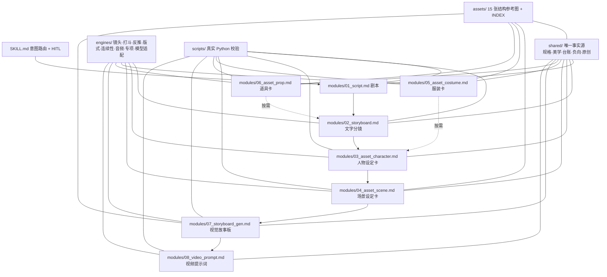

# QHSJ_AIGC_Operation_Modes_Lite

> **QHSJ · AI 全流程运营模式（轻量微内核）** — 从一句创意到成片提示词的工业级 Skill 路由系统。

<p align="center">
  
</p>

<p align="center">
  
  
  
  
  
  
</p>

## 核心特性

> [!IMPORTANT]
> **全流程闭环**：唯一主线 `剧本 → 分镜 → 人物设定卡 → 场景设定卡 → 故事板 → 配套视频提示词`。剧本/分镜强制走 `shared/standard_specs.md`，所有图片/视频提示词强制调用美学系统与运镜设计，交叉引用由 `ROUTING_CHECK.md` 与 `scripts/validate_workflow.py` 强制校验。

> [!IMPORTANT]
> **HITL 人机协同**：开工必问故事板类型与人物资产形态；超时默认 `G9_NO_BLANK`（九宫格无留白）+ `CHARACTER_SHEET`（人物设定卡）并标【参数假设】；极度模糊且无默认值立即暂停提问（`on_timeout: pause`，CI 场景 `fail`）。

> [!TIP]
> **按需渐进披露**：根 `SKILL.md` 只做意图路由；命中哪个模块才加载对应的 shared 服务、engines 引擎与 scripts 校验，绝不一次加载整库。

> [!TIP]
> **参考图≠输出样张**：`assets/` 内 15 张图只帮助 AI 理解设定卡结构、信息层级与一致性要求；不复制其像素、配色、字体、示例物体与遗留参数，默认不作为图生图输入。

## 微内核路由与交叉引用图



## 目录树

<details>
<summary>展开完整目录树</summary>

```text
QHSJ_AIGC_Operation_Modes_Lite/
├── SKILL.md                       # 根路由：Frontmatter + HITL + 意图路由
├── README.md                      # 本文件
├── ROUTING_CHECK.md               # 依赖闭环核对清单
├── LICENSE                        # MIT（保留原仓库许可）
├── shared/                        # 唯一事实源
│   ├── standard_specs.md          # 规格常量：画幅/网格/HITL/像素/模型
│   ├── aesthetic_system.md        # 美学 profile + 六层风格 + L1-L8
│   ├── originality_system.md      # 九类原创设计（按需）
│   ├── context_ledger.md          # 项目锚点台账 + 状态继承
│   └── negative_words.md          # 负向词四层装配 + 意图白名单
├── modules/                       # 业务模块（按需加载）
│   ├── 01_script.md               # 剧本引擎
│   ├── 02_storyboard.md           # 文字分镜表（SHOTS 接口）
│   ├── 03_asset_character.md      # 人物设定卡
│   ├── 04_asset_scene.md          # 场景设定卡（通用公式）
│   ├── 05_asset_costume.md        # 服装设定卡（M6 白膜人台）
│   ├── 06_asset_prop.md           # 道具设定卡（七形态）
│   ├── 07_storyboard_gen.md       # 视觉故事板（强依赖 01/02）
│   └── 08_video_prompt.md         # 配套视频提示词
├── engines/                       # 领域引擎
│   ├── camera_engine.md           # 镜头与运镜
│   ├── fight_engine.md            # 打斗/动作
│   ├── reverse_engine.md          # 反推
│   ├── layout_engine.md           # 版式与网格求解
│   ├── continuity_engine.md       # 连续性继承
│   ├── audio_engine.md            # 音频与字幕
│   ├── specialty_engine.md        # 巨物/赛车/蒙太奇/舞蹈/VFX
│   └── model_adapter.md           # 图片/视频模型编译
├── scripts/                       # 真实 Python 校验（全部可执行）
│   ├── calc_ratio.py              # 比例/R 值/版式推荐（JSON）
│   ├── calc_head_body.py          # 头身公式（JSON）
│   ├── validate_duration.py       # 时长/时间轴/快切/模型档
│   ├── validate_layout.py         # 网格公式/面积/边距/服装/全景
│   ├── validate_prompt.py         # 提示词契约/AE-CAM 调用/负向
│   ├── validate_workflow.py       # 六节点闭环 + 依赖矩阵 + 链接
│   ├── validate_assets.py         # 15 图哈希/INDEX/引用
│   └── run_checks.py              # 统一回归入口
├── tests/fixtures/                # 正反例黄金夹具
│   ├── duration_valid.json / duration_invalid.json
│   ├── layout_valid.json / layout_invalid.json
│   └── prompt_valid.json / prompt_invalid.json
└── assets/                        # 15 张结构参考图（原字节无损）
    ├── INDEX.md                   # 溯源：原名/新名/SHA256/像素/用途
    ├── scene_sheet_21x9.png
    ├── scene_sheet_9x16.png
    ├── prop_sheet_white.png
    ├── costume_sheet_white.png
    ├── storyboard_white_model_16x9.png
    ├── storyboard_white_model_9x16.png
    ├── aspect_ratio_adaptation.png
    ├── universal_layout_engine.png
    ├── grid_modes_nine_grid.png
    ├── interior_direction_sheet.png
    ├── material_modes_m1_m5.png
    ├── exterior_panorama_sheet.png
    ├── universal_style_formula.png
    ├── scene_formula_horizontal.png
    └── scene_formula_vertical.png
```

</details>

## 快速开始

```bash
# 全仓库自检（正反例夹具 + 全仓扫描）
python3 scripts/run_checks.py

# 单项使用示例
python3 scripts/calc_ratio.py --width 1920 --height 1080
python3 scripts/calc_head_body.py --height-cm 180 --head-count 9
python3 scripts/validate_duration.py tests/fixtures/duration_valid.json
```

## 联系方式

| 渠道 | 地址 |
|---|---|
| 微信 | `C0053224QM` |
| QQ | `3340565974@qq.com` |
| Google | `j3340565974@gmail.com` |

### 反馈规范

1. 反馈时请附 **规则 ID**（如 `AE-02`、`LAY-02`、`SP-03`）与复现输入，便于定位。
2. 图片/版式问题请注明：卡种、画幅作用域、模型、目标平台。
3. 校验失败请附 `scripts/run_checks.py` 输出与相关夹具文件。
4. 新需求先对照 `ROUTING_CHECK.md` 依赖矩阵，确认是否需同步修改 shared/engines/scripts。
5. 未经明确授权不推送、不重命名、不删除任何历史资产。
