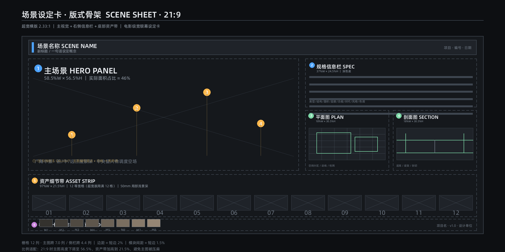
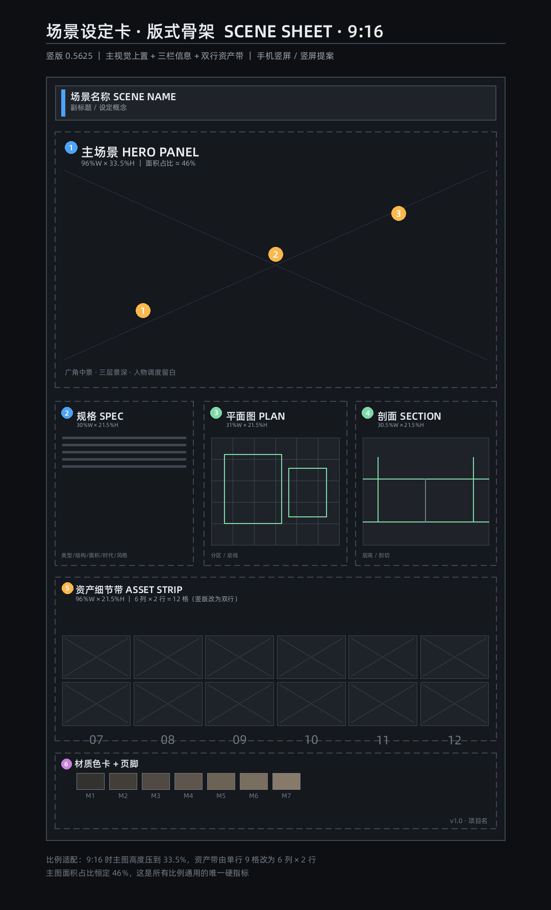
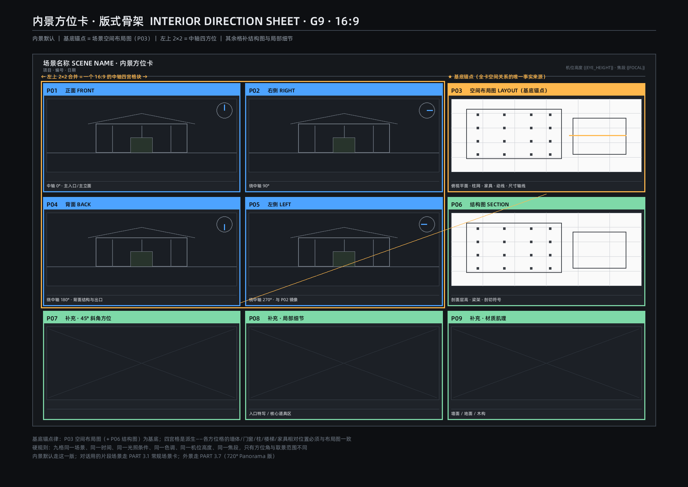
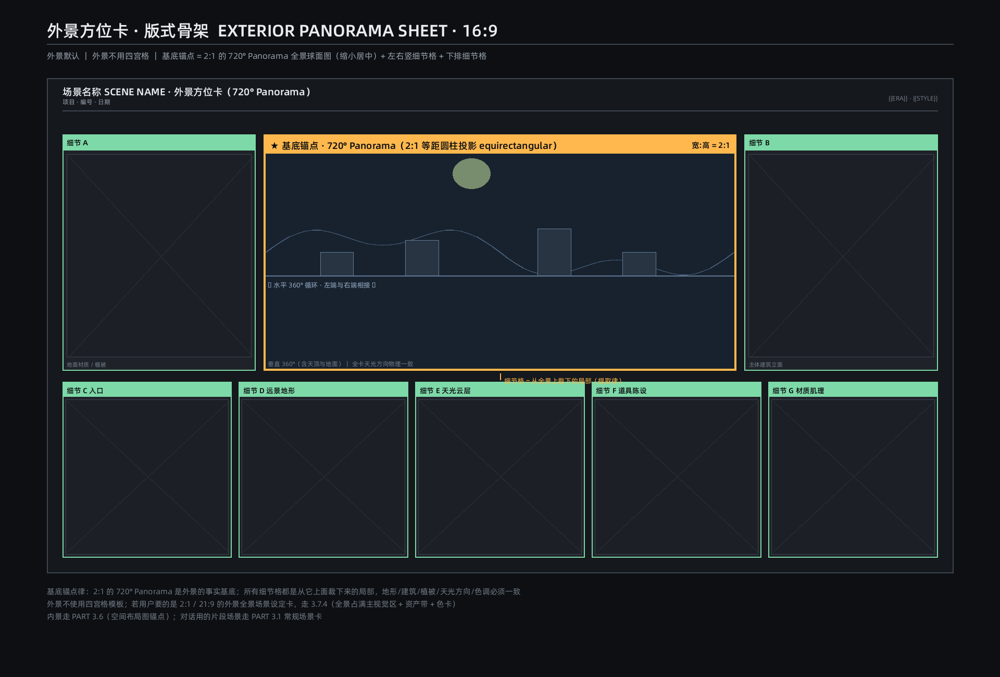
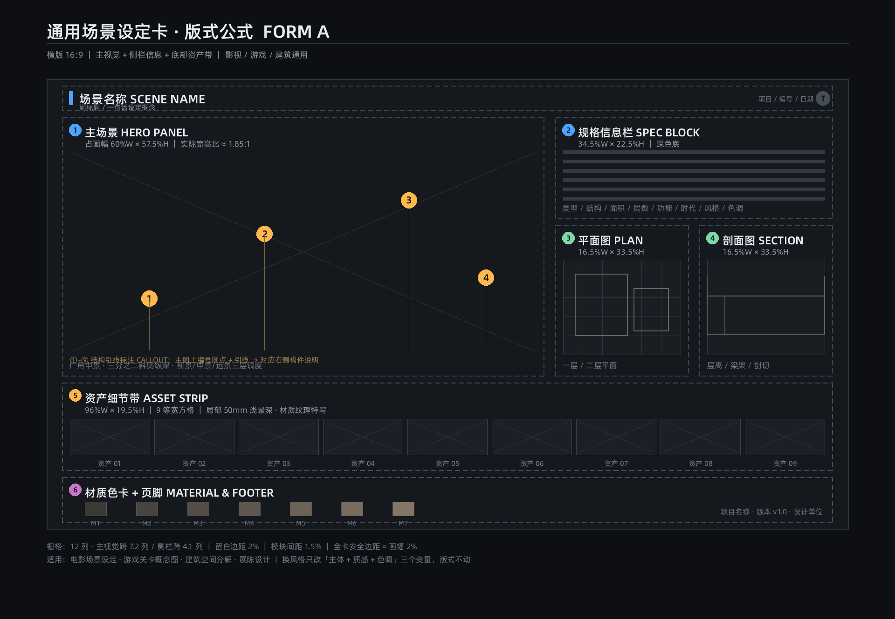
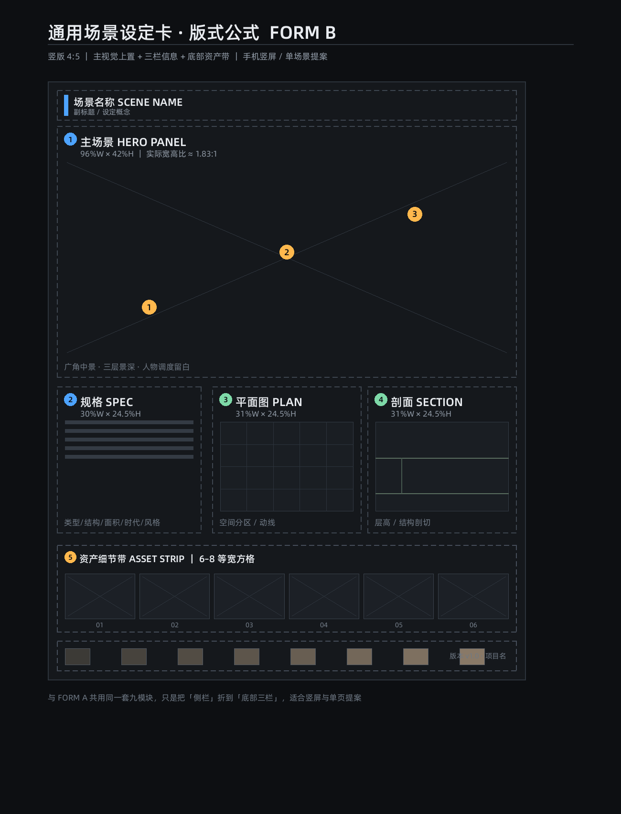

# 04 场景资产：通用场景设定卡公式

> 输出：常规场景卡 / 内景方位卡 / 外景全景卡 的生成提示词。本模块是**通用公式模板**，适配任何风格；风格只替换参数，不改变流程与校验。
> 依赖：`shared/standard_specs.md`、`shared/aesthetic_system.md`、`shared/context_ledger.md`、`shared/negative_words.md`、`engines/camera_engine.md`、`engines/layout_engine.md`。

## 04-01 通用公式（六步）

```
Step 1 输入事实：场景名、时代、地域、功能、气候、光线、使用者、资产清单
Step 2 作用域：asset_canvas_aspect（默认16:9）＋卡种分流（常规/内景/外景）
Step 3 版式求解：按 LAY 计算骨架、网格、面积、边距（不做固定百分比）
Step 4 内容提取：HERO主场景、平面/剖面、资产细节带、材质色卡（6-8色）
Step 5 风格注入：调用 aesthetic_system 风格档＋camera_engine 运镜
Step 6 装配校验：输出提示词，交 scripts/validate_prompt.py 与 validate_layout.py
```

**参考图仅结构参考**：以下图片帮助 AI 理解板块与信息层级，不是输出样张；不得复制其像素、配色、字体、示例物体与遗留参数。





## 04-02 卡种分流

| 需求 | 卡种 | 依据 |
|---|---|---|
| 单场景视觉设计、对话片段 | 常规场景卡 | 九模块版式 |
| 室内空间关系、多方位 | 内景方位卡 | 布局图基底 + G9 |
| 室外 360° 环境 | 外景全景卡 | 2:1 equirectangular |

## 04-03 常规场景卡

- 九模块：标题、HERO 主场景、规格信息、平面图、剖面图、资产细节带、材质色卡、引线、页脚。
- HERO：广角中景、前中远三层、中央预留调度区；资产带 6–12 格、50–100mm 微距；色卡 6–8 色。
- 画幅换算由 LAY 求解（21:9/16:9/3:2/4:3/1:1/9:16 等），不抄旧百分比。
- 背景：默认 `#FFFFFF`，浅色主体可改 `#F2F3F5`，主体与背景明度差 ≥40%（`asset_neutral` 场景豁免对比度硬门槛时须声明理由）。

## 04-04 内景方位卡



- 事实基底：空间布局图 P03；四方位 P01/P02/P04/P05（0°/90°/180°/270° 中轴）由同一布局派生；P06–P09 为结构图、斜角/俯仰、局部细节。
- 同场景、同时间、同光照、同色调、同机位高度、同焦段；方位与布局空间关系一致。
- 只要四方位可退回 G4，但必须保留布局锚点。

## 04-05 外景全景卡



- 基底：**水平 360°×垂直 180°、2:1 equirectangular**；“720°”只作产品名。
- 卡面 16:9：全景条约占卡宽 54%，左右各约 20.5%W 竖细节，下排 5 横细节，标题 6%H。
- 细节图必须与全景对应位置一致；通过等距圆柱→透视投影转换，禁止按平面矩形直接裁剪。
- 外景不使用四宫格。

## 04-06 场景公式横/竖版历史结构参考





- 两张为 legacy 版式结构参考，其中的旧“安全边距 2%”等参数已废止，以 `engines/layout_engine.md` 现行字段为准。

## 04-07 风格适配（任何风格）

- 写实、次世代/PBR、赛璐璐、水墨、像素、厚涂、三渲二、水彩等：只替换 `aesthetic_system` 的六层风格与八维参数，不改变九模块/方位/全景的必答内容。
- 水墨等艺术留白合法（`artistic_negative_space`），不触发负向；但镜格 `empty_cell` 仍禁止。

## 04-08 输出契约

```json
{
  "scene_id": "SCN_01",
  "card_type": "common|interior|exterior",
  "canvas_aspect": "16:9",
  "style": "来自 shared/aesthetic_system.md",
  "panorama": {"aspect": "2:1", "projection": "equirectangular", "fov_h": 360, "fov_v": 180},
  "modules": ["title","hero","plan","section","asset_strip","palette","legend","footer"],
  "validated_by": ["scripts/calc_ratio.py", "scripts/validate_layout.py", "scripts/validate_prompt.py"]
}
```

## 04-09 校验

- `scripts/calc_ratio.py`：画幅实际比例与误差。
- `scripts/validate_layout.py`：模块面积归一、边距字段、全景 2:1 定义。
- 失败修正至多三轮，仍失败进入 HITL 暂停。
