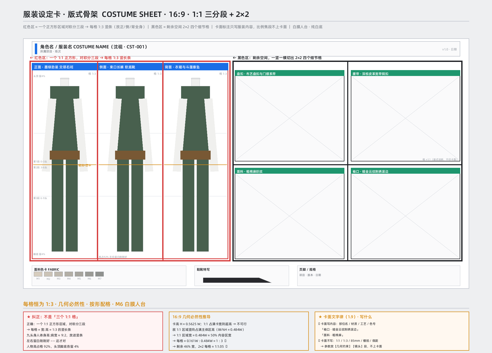

# 05 服装资产：服装设定卡

> 输出：默认 16:9、白底、M6 白膜人台＋全彩服装 的服装设定卡提示词。
> 依赖：`shared/standard_specs.md`、`shared/aesthetic_system.md`、`shared/context_ledger.md`、`shared/negative_words.md`、`engines/camera_engine.md`、`engines/layout_engine.md`。

## 05-01 输入与前置

- 输入：人物设定卡（`modules/03_asset_character.md`）的服装描述 + 剧本时代/身份/场合。
- 服装卡默认资产形态：白膜人台；开工缺人物资产形态时按默认 `CHARACTER_SHEET` 处理（见根路由 HITL）。

## 05-02 版式（唯一现行版，废止旧三 1:1 格）



- **一个 1:1 正方形区域，竖向三等分为三个 1:3 竖条**：依次正 / 侧 / 背。
- 右侧剩余空间为 2×2 细节格；长条细节可横向合并；细节四周余量 8%–10%。
- 16:9 主体区：左约 50%W×86%H，右约 46%W×86%H，底部 8%H。
- 废止旧规：三个 1:1 正方形格、三格各 30%W、方形物件改 1×4。

## 05-03 M6 白膜人台

- 人台白膜无头发、无发型、无妆容、无五官、无头饰，颈口平整。
- 服装、鞋靴、配饰全彩写实；“人是白膜，衣服是全彩”。
- 人物高度占格约 92%（顶/底各 4%）；默认九头身、85mm；细节 100mm。

## 05-04 三视图完全一致硬约束

- 三格同人台、同装束、同站姿、同比例；服装清单必须完全相同——正视图有的斗篷/外搭/配饰，侧背视图不得省略或变形。
- 服装与人物设定卡一致：卡面文字只写内容（物件名/部位/材质/工艺/色号），不写制作参数。

## 05-05 风格接入

- 背景默认 `#FFFFFF`；浅色服装可改 `#F2F3F5`；明度差 ≥40%。
- 风格参数（次世代、赛璐璐、水墨等）由 `shared/aesthetic_system.md` 提供；M6 是材质档，不因风格被替换。
- 负向由 `shared/negative_words.md` 动态装配：默认排除乱码、多余手指、非预期色彩，但不禁“人台”本身（白名单）。

## 05-06 输出契约

```json
{
  "costume_id": "COST_A",
  "canvas_aspect": "16:9",
  "material_mode": "M6",
  "background": "#FFFFFF",
  "region": {"main": "1:1 split into 3 x 1:3 (front/side/back)", "details": "2x2 right"},
  "garment_list": ["outer","inner","footwear","accessories"],
  "validated_by": ["scripts/calc_head_body.py", "scripts/validate_layout.py", "scripts/validate_assets.py"]
}
```

## 05-07 校验

- `scripts/validate_layout.py`：1:1→1:3 几何、人台占格 92%、细节余量。
- `scripts/validate_assets.py`：确认 `../assets/costume_sheet_white.png` 引用与哈希一致。
- 失败修正至多三轮，仍失败进入 HITL 暂停。
