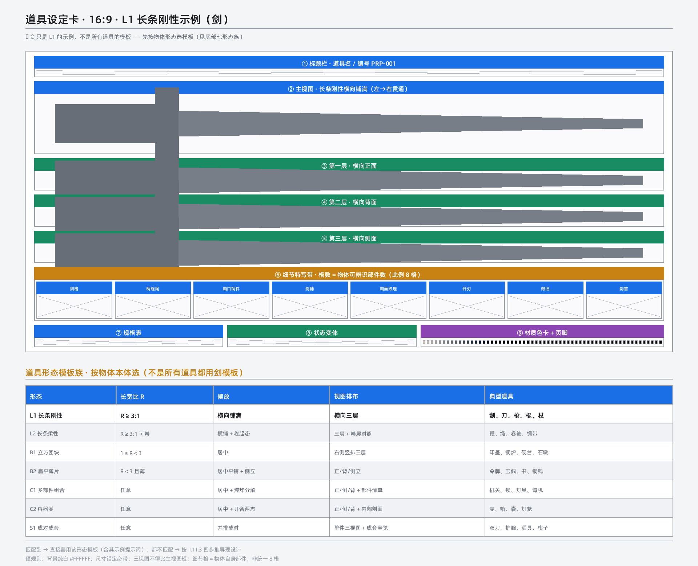

# 06 道具资产：道具设定卡

> 输出：默认 16:9、白底、M5 全彩写实 的道具设定卡提示词。版式由物体形态决定，不由卡种决定。
> 依赖：`shared/standard_specs.md`、`shared/aesthetic_system.md`、`shared/context_ledger.md`、`shared/negative_words.md`、`engines/layout_engine.md`。

## 06-01 输入与前置

- 输入：剧本道具清单 / 用户描述 / 反推结果（`engines/reverse_engine.md`）。
- 物体五维分析：`尺寸、形态、材质、结构、功能`；缺失维度不得脑补，缺关键维度进入 HITL。

## 06-02 摆放方向公式

```
object.elongation_r = max(width, height) / min(width, height)
```

- `R ≥ 3`：长条物体，横向三层（正面/背面/侧面），禁止竖放斜置导致“剑变短”。
- `1 ≤ R < 3`：立方团块，居中主图＋右侧正/侧/顶视图。
- 薄片：`R < 3` 且厚度显著小于另两维，正/背/侧立厚度。
- 命名空间隔离：本 R 与 `material.reflectance_r`、`geometry.aspect_r` 无关。

## 06-03 七形态模板族

| 形态 | 判定 | 版式要点 |
|---|---|---|
| L1 长条刚性 | R≥3，无变形 | 横向三层 |
| L2 长条柔性 | R≥3，可卷曲 | 展开三层＋卷起态 |
| B1 立方团块 | 1≤R<3 | 居中＋右侧三视 |
| B2 扁平薄片 | R<3 且薄 | 正/背/侧立厚度 |
| C1 多部件 | 可拆解 | 组装态＋爆炸图＋部件编号清单 |
| C2 容器 | 有内腔 | 闭合/开启＋内部剖面 |
| S1 成对成套 | 一组多件 | 整套全览＋单件三视＋左右差异 |



- 上图是 L1 长条示例，**不得套用到所有道具**。

## 06-04 同源与细节

- 所有视图同源等比：同一道具、同一材质、同一工艺，细节是提取不是重新设计。
- 细节数 = 可辨识部件数，不固定 8 格；细节 50–100mm 微距。
- 真实尺度锚定（示例基准）：佩剑 90–110cm、唐刀 100–130cm、匕首 20–40cm、长枪 200–300cm、手枪 18–25cm、步枪 90–120cm；其他道具用已知参照物锚定。

## 06-05 背景与风格

- 背景 `#FFFFFF`，浅色主体改 `#F2F3F5`；明度差 ≥40%。
- 风格参数由 `shared/aesthetic_system.md` 提供（asset_neutral 默认允许平光）；材质档 M5 全彩写实。
- 负向动态装配：排除乱码、多余部件、非预期材质；不全局禁用微距。

## 06-06 输出契约

```json
{
  "prop_id": "PROP_01",
  "form": "L1",
  "elongation_r": 4.2,
  "canvas_aspect": "16:9",
  "background": "#FFFFFF",
  "scale_cm": "90-110",
  "views": ["front","back","side"],
  "details": 3,
  "validated_by": ["scripts/calc_ratio.py", "scripts/validate_layout.py", "scripts/validate_assets.py"]
}
```

## 06-07 校验

- `scripts/calc_ratio.py`：R 值、方向、版式推荐与误差。
- `scripts/validate_layout.py`：七形态版式、资产格最小宽、同源等比字段。
- 失败修正至多三轮，仍失败进入 HITL 暂停。
