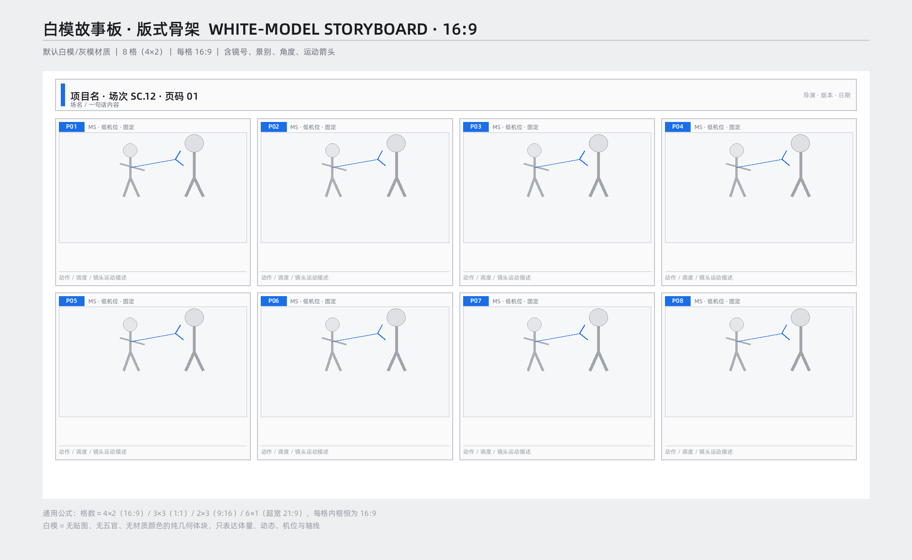
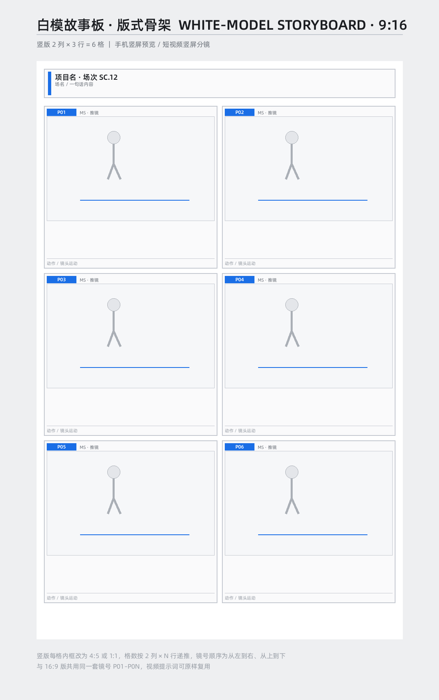
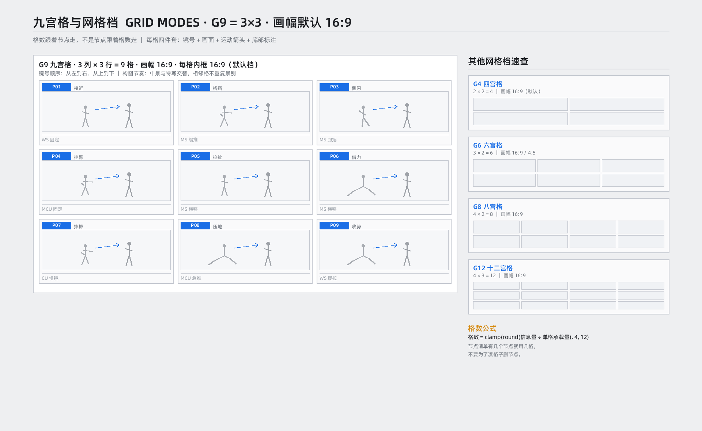
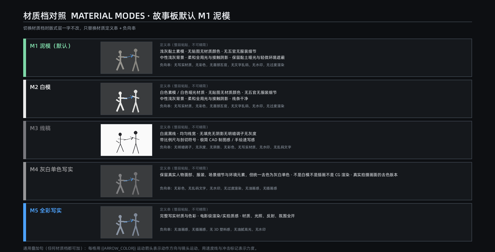

# 07 视觉故事板生成（强依赖剧本/分镜）

> 输出：视觉故事板（宫格图）生成提示词。**强依赖** `modules/01_script.md` 与 `modules/02_storyboard.md`：镜号、动作、景别、机位全部来自这两者的 SHOTS 接口，禁止脑补。
> 依赖：`shared/standard_specs.md`、`shared/aesthetic_system.md`、`shared/context_ledger.md`、`shared/negative_words.md`、`engines/camera_engine.md`、`engines/layout_engine.md`。

## 07-01 强制数据流（硬约束）

```
01 剧本 → 02 文字分镜(SHOTS) → 03/04/05/06 已验收资产锚点 → 07 关键帧提取 → 网格排版 → 提示词
```

- 未经验收登记的资产（人物/场景/道具）不得出现在故事板。
- 故事板不是“画一组动作”，而是把已有分镜关键帧提取后排成宫格。

## 07-02 关键帧提取律

- 提取源四选一（优先级）：① 剧本正文 ② 小说正文（先做叙述→动作转译，剥离心理/比喻/环境氛围）③ 文字分镜表 ④ 用户提示词已写节点。
- 每格只画被提取的那一帧：`{{SHOTS}}` 写什么动作就画什么，未写的动作/人物/道具/环境一律不出现。
- 节点不足 → 补可溯源过渡帧（起势/跟随/余韵），不脑补新情节；节点超出 → 合并同类节点或分页第二张板。
- 节奏骨架不变：`建立 → 接触 → 发力 → 转换 → 高潮 → 结果`。

## 07-03 默认档位（G9_NO_BLANK）

- 默认：画幅 16:9、3×3 九宫格、M1 泥模；**九格全填、无装饰性外留白、无空格**。
- 用户指定其他画幅/网格时用公式：`cell_r = canvas_r × rows / columns`（有间距时按间距预算修正）。
- 每格四件套：镜号标签（P01…）、画面、运动箭头、底部一行标注（景别＋镜头运动＋动作）。
- 镜号从左到右、从上到下；`Pxx` 与 02 的 SHOTS 一一对应。

## 07-04 网格档与画幅

| 网格 | 排布 | 说明 |
|---|---|---|
| G4 | 2×2 | 节点=4 或精简版 |
| G6 | 3×2 / 2×3 | 横/竖内容 |
| G8 | 4×2 | 节点=8 |
| G9 | 3×3 | 默认 |
| G12 | 4×3 / 6×2 | 节点=12 |

- 格数跟着节点走，不是节点跟着格数走；禁止为凑格删节点。

## 07-05 材质档（M1–M4）

| 档 | 用途 |
|---|---|
| M1 泥模（默认） | 前期 blocking、构图/机位/轴线评审 |
| M2 白模 | 干净体块、给客户看 |
| M3 线稿 | 动作结构示意、手绘提案 |
| M4 灰白单色写实 | 动作设计/打斗节奏评审（不是白模） |

- 切材质档只替换材质定义串＋负向串，版式层一字不改。

## 07-06 参考图（仅结构参考）









- 图 05 的 4×2 与整体 16:9 组合几何不成立，以 LAY-02 公式为准；`material_modes_m1_m5.png` 仅 M1–M5 历史示意，M6 见服装模块。

## 07-07 风格与运镜

- 提示词强制调用 `shared/aesthetic_system.md`（`storyboard_material` profile）与 `engines/camera_engine.md`。
- 构图节奏：中景与特写交替，相邻格不重复同一景别；每格运镜服从 SHOTS。

## 07-08 输出契约

```json
{
  "board_id": "SB_01",
  "canvas_aspect": "16:9",
  "grid": {"name": "G9", "rows": 3, "columns": 3},
  "blank_policy": "G9_NO_BLANK",
  "material_mode": "M1",
  "cells": [{"id": "P01", "source_shot_id": "P01", "action": "同02"}],
  "cell_aspect": 1.7777777777777777,
  "validated_by": ["scripts/validate_layout.py", "scripts/validate_workflow.py", "scripts/validate_prompt.py"]
}
```

## 07-09 校验

- `scripts/validate_layout.py`：网格公式、九格全填、无空格、面积与边距。
- `scripts/validate_workflow.py`：07 镜号 ⊆ 02 SHOTS、资产已登记。
- 失败修正至多三轮，仍失败进入 HITL 暂停。
