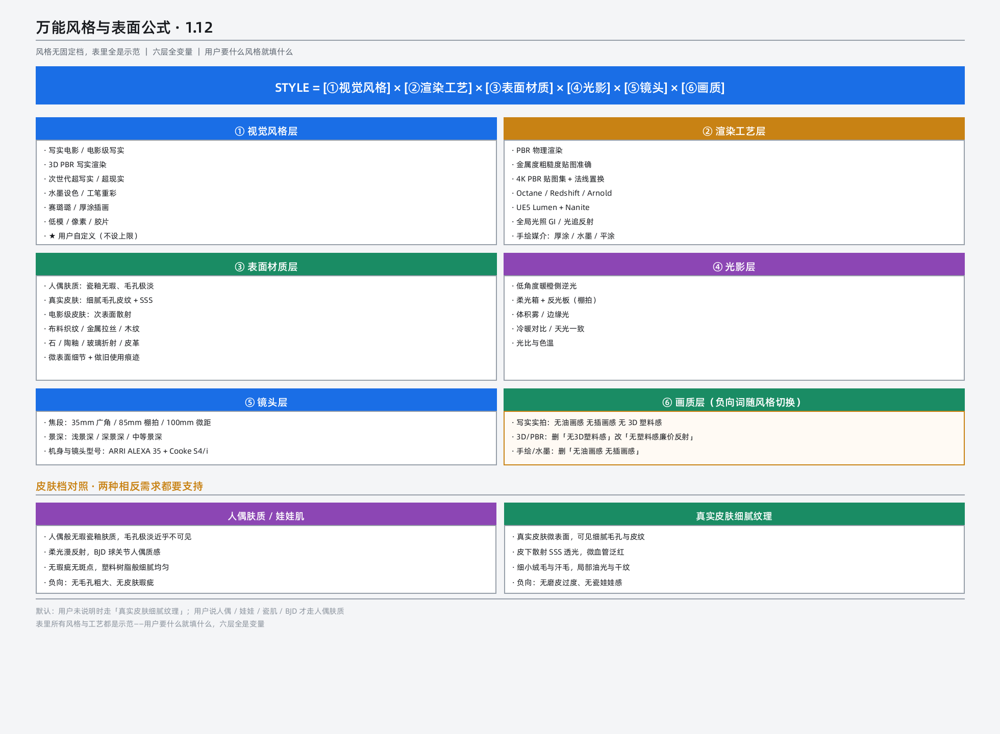

# 美学系统（aesthetic_system）

> 微内核共享服务。本文件是美学 profile、六层风格公式与八维参数域的唯一事实源；所有图片/视频提示词模块在装配前必须调用本文件与 `../engines/camera_engine.md`（运镜设计），二者缺一即违规输出。规则 ID 前缀 `AE-`，供校验脚本 `../scripts/validate_prompt.py` 引用。

## 0. 强制调用契约（AE-00）

- AE-00-1 任何图片提示词、视频提示词在动笔前，必须先确定一个美学 profile（第 1 节），再按第 2–5 节完成风格定量，最后交给运镜设计。
- AE-00-2 文字交付物（剧本、分镜表）不受美学门约束，但仍须过各自模块的质检关。
- AE-00-3 心理、气氛、主题必须外化为可观测画面元素（肌肉、呼吸、视线、距离、光斑、粒子、色块）；前台禁止纯心理描述。
- AE-00-4 技术参数（焦段、光圈、渲染引擎、LUT、分辨率）属模型控制层，集中在提示词尾部一个参数块内，不与画面语言混排。
- AE-00-5 静帧图片禁止把"摄影机运动过程"写成字段；只允许写被摄体运动痕迹（弧光、残影、拖影、飞溅）与画面呈现的运动效果（速度线）。视频媒介不受此限，必须写运镜起点、轨迹、落幅。



## 1. 美学 profile（AE-01）

不同交付物对光影、景深、质感的要求不同。按 profile 执行，禁止把 cinematic 标准强加给中性资产：

| profile | 适用 | 光影 | 景深 | 负向倾向 |
|---|---|---|---|---|
| `cinematic` | 剧照、概念图、成片帧 | 必须有主光方向与明暗对比，平光打回（除非剧本明确要求平光叙事） | 前中后三层分明 | 排除平光、塑料感、乱真元素 |
| `asset_neutral` | 角色正视图、四/五视图、道具图 | 允许影棚均匀柔光、极低反差，允许平光 | 主体清晰，无戏剧景深 | 排除投影、强对比、戏剧光 |
| `technical_diagram` | 线稿、白模、版式卡、技术图纸 | 无影/极简全局光 | 不强制三层景深 | 排除写实材质、彩色、乱码 |
| `storyboard_material` | 故事板、白模分镜格 | 按 M1 泥模默认（材质档见 `standard_specs.md`） | 每格独立构图 | 排除写实渲染、贴图细节 |
| `preserve_superres` | 超分重绘 | 逐字沿用原图光影，禁止新增方向性光源 | 沿用原图 | 排除一切构图/元素/风格变更 |

- AE-01-1 "人物永远比背景亮"仅在 `cinematic` 下生效；`asset_neutral` 白底资产图、剪影、`technical_diagram` 不适用该条。
- AE-01-2 美学自检十问（焦点唯一、焦点突出、光影戏剧性、色彩主见、构图章法、质感可触、空间纵深、情绪外化、动静对比、无多余元素）按 profile 裁剪：`asset_neutral`/`technical_diagram` 免检光影戏剧性与空间纵深两项，其余逐项执行。

## 2. 六层风格公式（AE-02）

```
风格 STYLE = [① 视觉风格层] × [② 媒介/渲染工艺层] × [③ 表面材质层]
           × [④ 光影层] × [⑤ 镜头层] × [⑥ 画质层]
```

- AE-02-1 ①②④⑤⑥ 五层必填；③表面材质层按需。①视觉风格层用户说什么就写什么，不设上限；②渲染工艺层对 3D/PBR/次世代类必填。
- AE-02-2 画风融合写法：`主风格 70% + 副风格 30%`；副风格必须写明"仅挪用哪一层"，禁止副风格全层生效（画风漂移主要来源）。
- AE-02-3 各层冲突时走冲突预判：修正动作只有"降权重"或"换媒介"两种，禁止两个冲突项各占 100%。典型冲突对：水墨留白↔霓虹点光、厚涂↔平光、写实骨相↔Q版头身、胶片颗粒↔超清PBR、二次元五官↔皮肤毛孔、高饱和撞色↔莫兰迪。
- AE-02-4 用户指定技法词与预设冲突时，以用户指定为准，并在参数层标注"覆盖默认"。

## 3. 风格 OS 八维参数域（L1–L8）（AE-03）

每一维给出取值域与量化写法；装配时原样拼进参数层，量化格式统一为"维度名 = 数值 + 单位"。

| 维度 | 核心参数与取值域 | 硬规则 |
|---|---|---|
| L1 造型 | 头身比 2–10；写实骨相 0–100；二次元夸张度 0–100；眼位 0.38–0.50；五官精度 stylized/semi-realistic/photorealistic | 骨相与夸张度不得同时高于 70，命中即走 AE-02-3 冲突预判 |
| L2 线条 | 轮廓 none/hint/clear/heavy；线宽 0.5–6；抖动 0–100；起收笔 butt/round/tapered/calligraphy | — |
| L3 上色 | flat/gradient/impasto/wet wash/halftone；色块硬度 0–100；叠色层数 1–7 | — |
| L4 笔触/肌理 | 笔触可见度 0–100；纸纹强度 0–100；颗粒 none/film/digital/canvas；数码感 0–100 | — |
| L5 光影 | 五通道：Key（soft/hard，0°–90°，0–100）、Fill（0–80%）、Rim（off/low/mid/high + 色温K）、体积光（0–100）、Ambient（HDRI/天光/反射球） | 预设光型可直接引用：伦勃朗、蝴蝶光、双轮廓背光、电影三点光、平光柔光、硬光高对比、体积光雾 |
| L6 媒介 | 唯一主媒介，八选一：次世代3D PBR / 影视级CG / 2D手绘赛璐璐 / 厚涂油画 / 胶片实拍 / 三渲二 / 水彩 / 像素 | 主媒介唯一且必须带唯一锚点词（中英双语各一）；副媒介只能以副风格身份出现，权重 ≤30% |
| L7 材质 | 每材质四参数：亮度 B、反射率 R、粗糙度 G、做旧 W，均 0–100 | 主体 1 + 次要 1 + 做旧 1，共 ≤3，超出按权重裁剪；皮肤快捷：SSS 开启，R18 G28 B88 |
| L8 色调 | 色相 0°–360°；饱和 0–100；冷暖 -100–+100；明度 0–100 | 必须给 hex 三色组（主/辅/暗部），禁止只写形容词 |

- AE-03-1 L6 主媒介确定提示词主语法；防画风漂移第一道防线。
- AE-03-2 反塑料感开关：Rim ≥ mid 且 Key 硬度 ≤ 40 时，塑料感自动降一档，同时负向词库（`negative_words.md`）自动加入对应塑料感排除项。

## 4. 感觉词预设（AE-04）

用户输入抽象感觉词时，先查表翻译为 L1–L8 参数，再进入装配；一词可触发多维联动。与用户明确指定的技法词冲突时以用户为准。

| 感觉词 | L1 造型 | L3/L4 上色笔触 | L5 光影 | L7 材质 |
|---|---|---|---|---|
| 高级感 | 8.5 头身；骨相 75；眼位 0.46 | 渐变上色；笔触 30；细胶片颗粒 | 蝴蝶光，Fill 25% | 哑光陶瓷 B80 R20 G15 |
| 特别好看/绝美 | 8.5–9 头身；骨相 85；写实五官 | 渐变；笔触 20 | 蝴蝶光 + Rim high 6000K | 皮肤 SSS；发丝各向异性 |
| 电影感 | 7.5–8 头身；骨相 70 | 胶片颗粒 ISO400；笔触 10 | 三点光 + 体积光 40 + 色温分层 | 织物/皮肤 B70 R30 G40 |
| 赛博朋克 | 7.5 头身；夸张度 20 | 渐变 + 霓虹辉光；硬度 80 | 硬光高对比 + 霓虹点光×3 + 体积光 60 | 金属/玻璃高反 |
| 治愈/温柔 | 6.5–7 头身；眼位 0.48；夸张度 40 | 平涂软笔触；纸纹 30 | 正前柔光 + Fill 60% | 棉麻 B90 R8 G65 |
| 史诗/宏大 | 8 头身；骨相 65 | 厚涂；笔触 70 | 逆光 + 体积光 80 + 尘埃 | 石材/金属做旧 W60 |
| 复古/年代感 | 7 头身；骨相 55 | 晕染；胶片颗粒 60；数码感 15 | 自然光 + 单窗光（伦勃朗式） | 旧织物 W50 褪色 |
| 二次元/动漫 | 6–7 头身；骨相 0；夸张度 70–90 | 平涂；硬度 90 | 平光 + 硬边二分 | 赛璐璐 B95 R5 G5 |

- AE-04-1 出现具体 IP/作品/画师名或纯抽象感觉词时，先做视觉基准对齐（检索视觉特征、光照模式、材质倾向、色彩基准），提炼结果必须落成可代入八维的参数而非形容词堆砌；纯技法描述可直接进装配。

## 5. 权重适配（AE-05）

- AE-05-1 主风格锚点权重 60%–80%；副风格仅挪用其 1–2 个层，其余层归零。
- AE-05-2 主副风格之和必须等于 100%；八维权重在每一层内归一化到 100%。
- AE-05-3 按媒介选画质锁定词，不混用：3D/CG 用"影视级画质、物理准确光照"；手绘用"高清手绘、线条锐利"；油画用"笔触可见、博物馆级"；胶片用"颗粒自然、肤色通透"。

## 6. 装配顺序与双语输出（AE-06）

- AE-06-1 装配顺序固定：画质锁定 → 主体描述 → 风格锚点（L6 唯一锚点词）→ L1–L5 参数化描述 → L7 材质数值 → L8 色调 hex → 镜头/画幅。
- AE-06-2 中文母版为母本；中文友好模型直接中文输出，英文友好模型转英文输出；用户未指定模型时逐条输出中英双语两套。
- AE-06-3 L6 主媒介的唯一锚点词在对应语言版本中必须出现，禁止省略。
- AE-06-4 参数层输出逐项列出 L1–L8；任何一段缺失视为装配失败。

## 7. 交叉引用

- 画幅作用域、网格、材质档 M1–M6、生成档/交付档：`standard_specs.md`
- 负向词按 profile/媒介动态筛选：`negative_words.md`
- 运镜三段式、机位、轴线：`../engines/camera_engine.md`
- 版式与网格求解：`../engines/layout_engine.md`
- 模型编译输出：`../engines/model_adapter.md`
