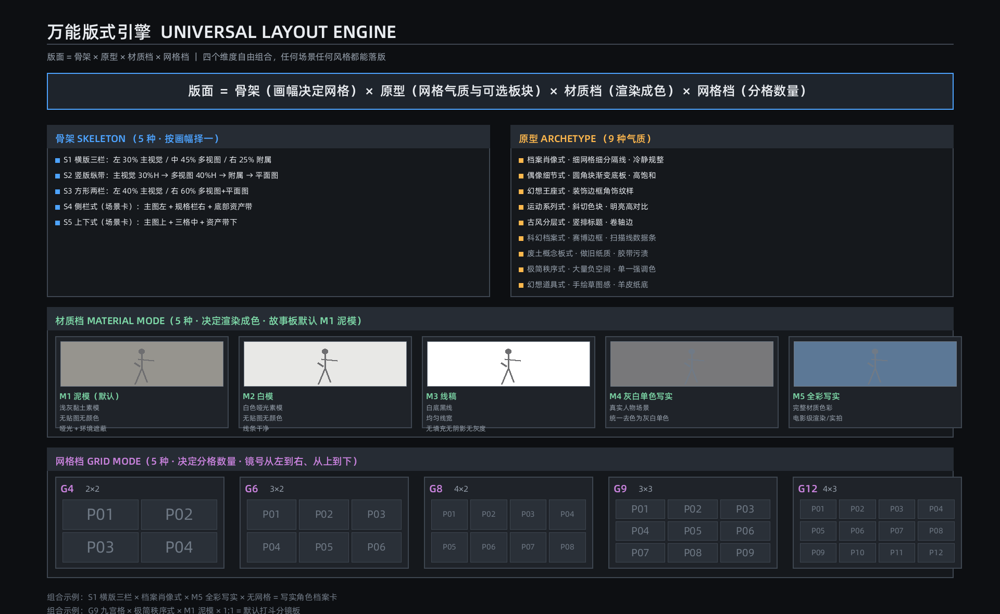
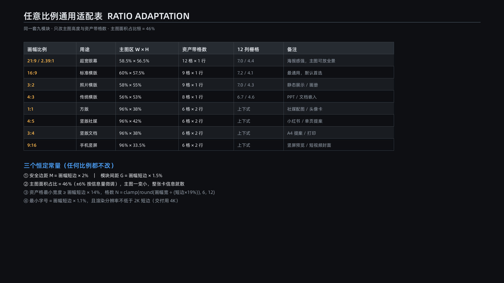

# shared/standard_specs.md — 规格常量与全项目契约（唯一事实源）

> Skill v1.5.2 共享服务。本文件是画幅、比例、默认值、HITL 契约、网格公式、模型档案的**唯一存放处**。模块与引擎禁止复制第二套默认值；冲突裁决以本文件为准。

## SP-01 优先级链

`安全 > 用户显式变更 > 剧本事实 > 连续性台账 > 模板默认`

## SP-02 画幅作用域（四层独立）

| 作用域 | 字段 | 默认/规则 |
|---|---|---|
| 项目成片 | `project_aspect` | 短剧/手机端默认 9:16（竖屏）；漫剧/电影感默认 16:9 |
| 资产卡面 | `asset_canvas_aspect` | 所有卡种默认 16:9，可按内容选 21:9/9:16/3:2/4:3/1:1/2:3/3:4/4:5 |
| 镜格 | `cell_aspect` | 由网格公式反推，不固定 16:9 |
| 全景 | `panorama_aspect` | 固定 2:1，水平 360°×垂直 180°（equirectangular） |

四层独立校验，禁止跨层强迫同值。

## SP-03 开工必问与超时契约（HITL）

| 问题 | 默认值 | 超时行为 |
|---|---|---|
| 故事板类型 | `G9_NO_BLANK`（3×3、九格全填、无装饰性外留白） | 采用默认，标【参数假设】 |
| 人物资产形态 | `CHARACTER_SHEET`（人物设定卡） | 采用默认，标【参数假设】 |
| 图片模型 | `Seedream 5.0 Flash`（源文历史默认；用户配置优先） | 采用默认 |
| 视频模型 | `Seedance 2.0`（纯图片任务免问并注明无视频环节） | 采用默认 |
| 画幅 | 按 SP-02 内容规则 | 采用默认 |
| 极度模糊且无安全默认 | 无 | `on_timeout: pause`（CI 校验场景 `fail`），输出明确问题，禁止编造 |

规则：先收集用户已给信息，缺项一次性问清；用户已给或说“你来定”的不重复问；禁止先产出再补问。

## SP-04 标准全流程（唯一主线）

```
剧本 → 分镜 → 人物设定卡 → 场景设定卡 → 故事板 → 配套视频提示词
01_script → 02_storyboard → 03_asset_character → 04_asset_scene → 07_storyboard_gen → 08_video_prompt
```

- 服装（05）、道具（06）、打斗、反推、专项、原创设计为**按需子节点**，不搭售。
- 剧本/分镜必须走本文件；所有图片/视频提示词必须调用 `shared/aesthetic_system.md` 与 `engines/camera_engine.md`。
- 资产验收登记进 `shared/context_ledger.md` 后，故事板/视频才可引用。

## SP-05 网格公式（替代照表）

```
canvas_r = canvas_w / canvas_h
cell_r = canvas_r * rows / columns
```

- G4=2×2、G6=3×2/2×3、G8=4×2、G9=3×3、G12=4×3/6×2；镜号从左到右、从上到下。
- 有间距时以间距预算修正；所有组合由 `scripts/validate_layout.py` 验算。

## SP-06 版式常量

- 纵向三段：标题 5% + 内容区 88% + 底部 7% = 100%；纯文字区 ≤12%。
- 内容区板块配比归一化合计 100%；主视觉为全卡最大单一板块。
- **废止**：全局“主图恒 46%±6%”、未归一化的 34/38/28 硬常量、旧“安全边距=短边 2%”。
- 边距五字段：`outer_margin ≤1.5%`、`module_gap=短边×1.5%`、`inner_padding`（如服装细节 8%–10%）、`artistic_negative_space`（艺术留白合法）、`empty_cell`（故事板禁止）。

## SP-07 卡种关键几何

- 服装：一个 1:1 区域纵分三个 1:3（正/侧/背）＋右侧 2×2；人台占格 92%；废止旧三 1:1 格。
- 道具：`object.elongation_r = max(w,h)/min(w,h)`；R≥3 长条横向三层，1≤R<3 团块；与 `material.reflectance_r`、`geometry.aspect_r` 命名空间隔离。
- 人物：`head_length = height / head_count`；显式 N 优先，仅身高时按 20cm 估算，默认 N=9 不反推固定 20cm。
- 外景：2:1 等距圆柱 360°×180°；“720°”只作产品名；细节用投影转换，禁止平面裁剪。

## SP-08 生成与交付像素

- 生成档 0.8–1.8MP，尺寸满足模型步长（无特殊要求时取 8 的倍数）；交付档 2K/4K/6K 按项目选择。
- 候选像素必须输出实际比例与误差；参考图像素（如 2100×1050）不作为生成尺寸。

## SP-09 材质档

- M1 泥模（故事板默认）、M2 白模、M3 线稿、M4 灰白单色写实、M5 全彩写实（其余卡种默认）、M6 白膜人台（服装卡）。
- 资产图 `../assets/material_modes_m1_m5.png` 仅 M1–M5 历史示意，M6 以服装规范为准。

## SP-10 模型档案与适配

- 模型默认值见 SP-03；平台能力差异由 `engines/model_adapter.md` 编译。
- 任何未实测的模型能力必须标 `unknown`，禁止虚报。

## SP-11 提示词 schema 与卡面文字律

- 所有生成提示词必含：主体/锚点、画幅作用域、机位运镜（CAM）、风格档（AE）、负向装配（NEG）、模型字段。
- 卡面文字只写内容信息（物件名/部位/材质/工艺/色号）；制作参数进几何/镜头/画质段，不印卡面。

## SP-12 校验契约

| 脚本 | 校验内容 |
|---|---|
| `scripts/calc_ratio.py` | 比例、R 值、版式推荐、误差 |
| `scripts/calc_head_body.py` | 头身公式与锚点 |
| `scripts/validate_duration.py` | 台词/停顿/时间轴/fps/快切/模型档 |
| `scripts/validate_layout.py` | 网格公式、面积归一、边距、服装/全景几何 |
| `scripts/validate_workflow.py` | 六节点闭环、交叉引用、依赖矩阵 |
| `scripts/validate_prompt.py` | schema 字段、美学/运镜调用、负向装配 |
| `scripts/validate_assets.py` | 15 图哈希、INDEX、图片链接 |
| `scripts/run_checks.py` | 汇总全部检查 |

校验失败修正至多三轮，仍失败输出失败规则 ID 并进入 HITL 暂停（禁止无限循环）。

## SP-13 参考图契约（最高指令之一）

参考图只帮助 Skill AI 理解板块结构、信息层级、视图关系与一致性要求；**不是输出样张、不是图生图输入（除非用户指定）**。禁止复制参考图像素、配色、字体、装饰、示例物体与遗留参数。




